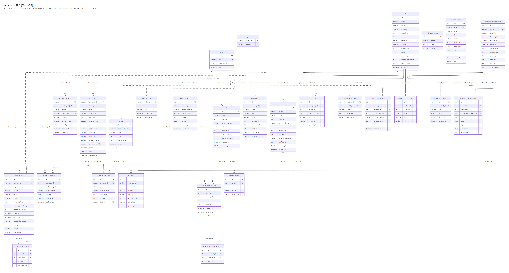
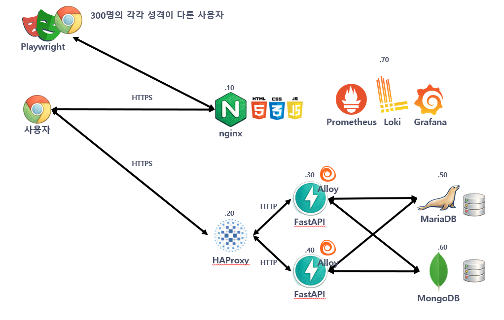
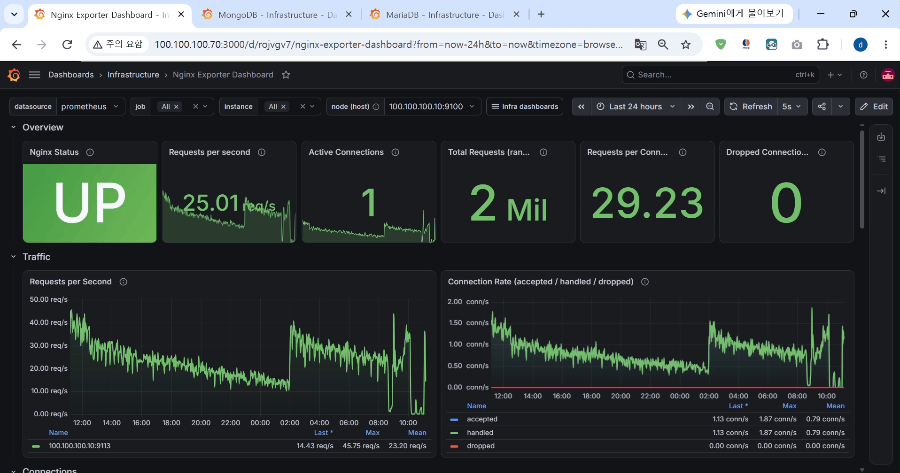

# 1. 팀 소개
**팀명: 강사입니다.**

| 심준보 |
|---|
|  |
| [@ddarahakit2024](https://github.com/ddarahakit2024) |

   

# 2. 프로젝트 개요
### 프로젝트명
moaparts

### 프로젝트 소개
PC 부품의 가격을 한곳에서 비교하는 서비스를 통해 사용자들이 서비스를 이용하면서 발생하는 데이터를 수집하는 프로젝트

### 프로젝트 필요성
상품 추천, 가격 하락 예측, 고객 성향 분류 같은 모델은 사용자가 서비스를 이용하며 남긴 행동·거래 데이터로 학습한다. 
이를 위해 필요한 데이터를 실제 서비스에서 수집되는 데이터 파이프라인과 동일하게 구성하여 MLOps의 데이터 수집 과정을 이해한다.

### 프로젝트 목표

**1) PC 부품 가격 비교 서비스 구현·배포**

- 다양한 상품을 서비스로 제공(8개의 카테고리 400개의 상품)
- 판매처별 가격 비교, 가격 변동 그래프, 1년 최저가, 가성비 지수 제공
- 회원가입·소셜 로그인, 장바구니·결제(PortOne)·반품, 리뷰, 커뮤니티(질문·자유·견적 게시판) 기능

**2) 데이터 수집**

| 원천 | 저장 위치 | 수집 내용 |
| --- | --- | --- |
| nginx 접근 로그 | 파일(JSON Lines) | 요청 경로, 상태 코드, 응답 시간, request_id |
| FastAPI 요청 로그 | 파일(JSON Lines) | API 호출, 사용자, 응답 시간, 오류 |
| 거래·커뮤니티 데이터 | MariaDB | 회원, 주문·결제, 반품·환불, 리뷰, 게시글·견적 |
| 사용자 행동 이벤트 | MongoDB | 노출·클릭·체류 시간·검색·비교함·장바구니 등 37종 |
| 판매처 가격 | MariaDB(가격 이력) | 자사·쿠팡·네이버 가격 변동(모의 시장 가격 모델 + 크롤링을 통한 수집) |

   

# 3. 기술 스택

| 프론트엔드 | 백엔드 | DB | 테스트 | 인프라·배포 | 데이터 수집 |
| --- | --- | --- | --- | --- | --- |
|    |        |   |   |      |  |

   

# 4. WBS

| 구분 | 작업 | 세부 내용 | 기간 | 상태 |
| --- | --- | --- | --- | --- |
| 1. 기획 | 서비스·데이터 수집 기획 | 주제 선정, 서비스 기능과 수집할 데이터 정의 | 10/30 ~ 11/03 | 완료 |
| 2. 환경·배포 | 개발·배포 환경 구축 | Docker Compose 로컬 환경, AWS(EC2·RDS·S3) 인프라, GitHub Actions 자동 배포 | 10/21 ~ 10/31 | 완료 |
| 3. 서비스 개발 | 쇼핑몰 기본 기능 | 회원·소셜 로그인, 상품, 장바구니·결제, 주문 내역 | 10/20 ~ 10/30 | 완료 |
| | 부가 기능 | 상품 카탈로그(400개), 가성비 지수, 리뷰, 커뮤니티, 반품 | 10/30 ~ 11/04 | 완료 |
| | 가격 비교 기능 | 판매처별 가격 비교, 가격 변동 그래프, 1년 최저가·목표가 알림 | 11/05 ~ | 진행 중 |
| 4. 데이터 수집 | 로그·이벤트 수집 | nginx·FastAPI 로그(JSON Lines), 사용자 행동 이벤트(MongoDB) | 10/30 ~ 11/01 | 완료 |
| | 판매처 가격 수집 | 모의 시장 가격 모델, 크롤링을 통한 가격 수집 | 11/01 ~ 11/02 | 완료 |
| | 가상 사용자 시뮬레이터 | Playwright로 여러 사용자가 실제처럼 서비스 이용 | 10/31 ~ 11/02 | 완료 |
| | 데이터 수집 운영 | 시뮬레이션 실행, 수집 데이터 점검 | 11/02 ~ | 진행 중 |
| 5. 마무리 | 산출물 정리 | 요구사항 명세서, ERD, 시스템 아키텍처, 수행 결과 | 11/09 ~ | 진행 중 |

   

# 5. 요구사항 명세서
| [Issue 확인](https://github.com/ddarahakit2024/mlo-03-p1-team0/issues?q=is%3Aissue+state%3Aclosed) |

# 6. ERD

# 7. 주요 프로시저

# 8. 수행결과(테스트/시연 페이지)
- ### 서비스 이용 자동화

다양한 사용자들이 각자 다른 페르소나로 서비스를 이용하도록 자동화
총 200명의 페르소나를 만들고 최대 50명까지 동시에 접속하도록 설정

- ### 초당 RPS

Nginx 서버 모니터링 화면. 최대 50 RPS, 평균 25 RPS로 사용자들이 접속하고 있는 모습

- ### 정형 데이터 적재

Mariadb 서버 모니터링 화면. 대부분의 사용자들이 SELECT 쿼리로 서비스를 이용. 주문 및 결제, 커뮤니티 이용은 ~~~ 정도 이용하는 모습

- ### 이벤트 로그 데이터 적재

MongoDB 서버 모니터링 화면. 초당 2건씩 데이터가 저장되는 모습. 클라이언트는 프론트엔드에서 최대 10개까지 큐에 이벤트를 적재하고 10개가 넘으면 서버로 전송. 10개가 되지 않더라도 5초에 1번 서버에 전송하고 페이지에서 나갈 때도 전송하도록 설정

# 9. 한 줄 회고
| 팀원 | 한 줄 회고 |
|---|---|
| 심준보 | 서버 설정하고 서비스 개발하고 자동 데이터 수집 파이프라인 만들고 어려워요. |

